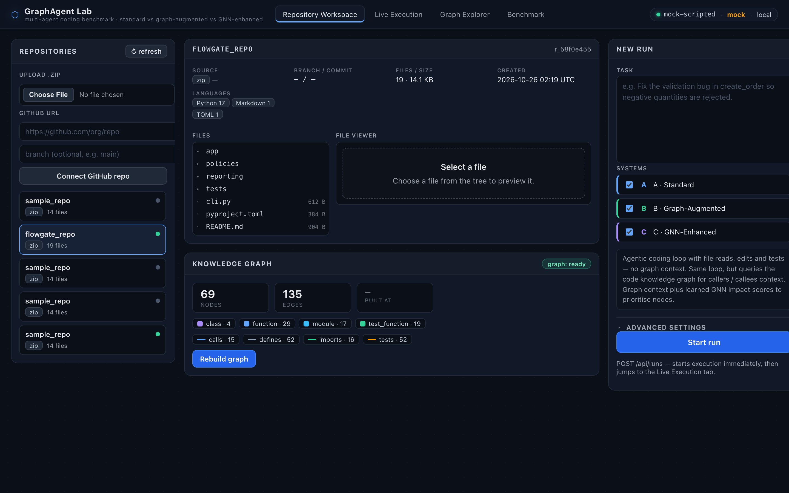
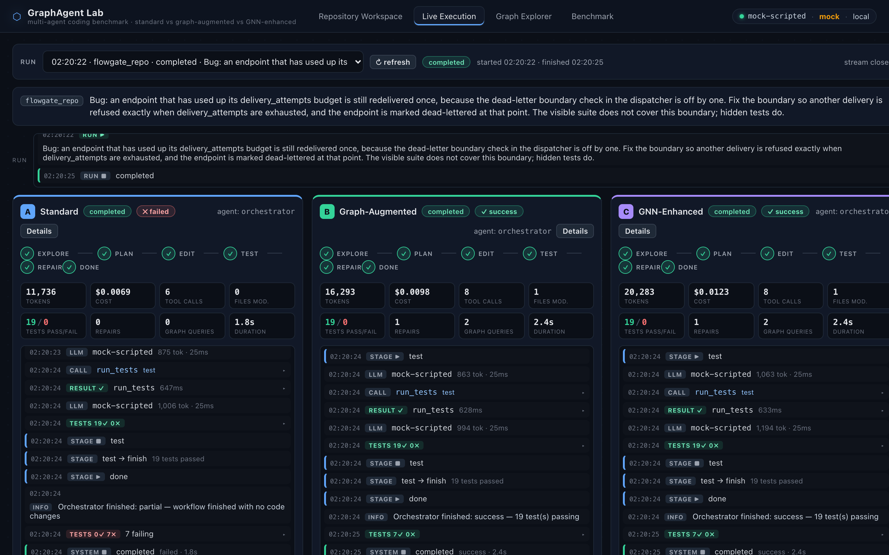
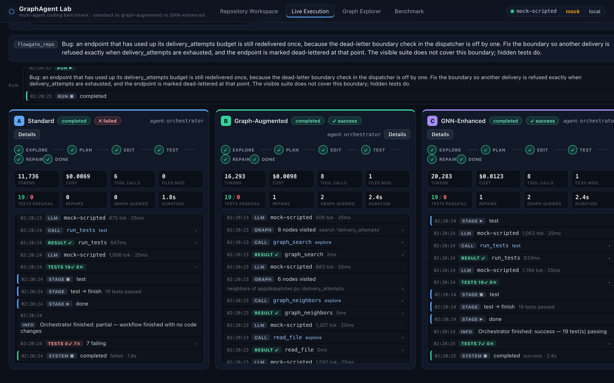
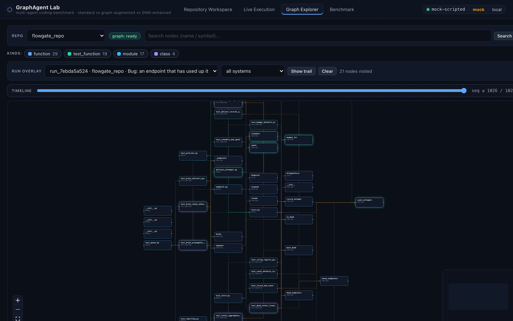
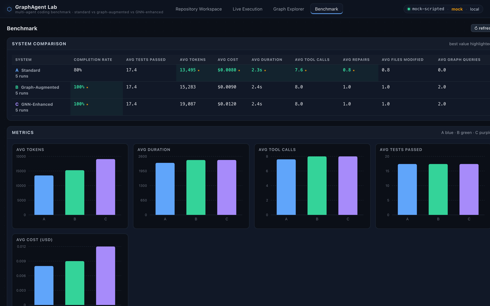

# GraphAgent Lab

**Does code-graph intelligence actually make coding agents better?**
GraphAgent Lab runs three competing multi-agent systems on the same bug-fix
task — identical LLM, identical prompts, identical tools — varying only one
thing: access to a Tree-sitter-built **code knowledge graph**. Every run is
streamed live, graded against hidden tests, and rolled up into a comparison
dashboard.

```
 A · Standard           B · Graph-Augmented        C · GNN-Enhanced
 file tools only        + graph traversal          + learned impact scores

 grep, hope it's        search symbols, walk       rank what matters
 the right file         callers/callees            before reading anything
```

Over 5 runs: System A completes **80%** of tasks, Systems B and C complete
**100%**. On the adversarial `flowgate` task, A scores **0/7 hidden tests**
while B and C score **7/7**.

## Screenshots

### Repository Workspace

Upload a `.zip` or clone from GitHub, build the graph, pick the systems, write
the task.



### Live Execution

All three systems run the task side by side, streamed over SSE, with stage
pipelines, metrics, and a per-system event timeline. Here A fails the flowgate
task (`0✓ 7✗` hidden) while B and C succeed (`7✓ 0✗`).



### Graph navigation in the event log

System A greps `delivery_attempts` and lands in two same-named decoy modules.
System B queries the knowledge graph instead and gets an exact symbol match on
`app/dispatcher.py::delivery_attempts`.



### Graph Explorer

Every graph query is recorded. Select a run overlay to replay each system's
visit trail over the graph.



### Benchmark dashboard

Completion rate, tests, tokens, cost, duration, tool calls, repairs, files
modified, and graph queries — as a table, bar charts, a radar profile, and a
per-run breakdown.



## How it works

```
┌──────────────────────────────────────────────────────────────────────────┐
│  React + TS + React Flow + Recharts (frontend/)                         │
│   Workspace · Live Execution (SSE) · Graph Explorer · Benchmark          │
└───────────────────────────────▲──────────────────────────────────────────┘
                                │ /api  (docs/API.md)
┌───────────────────────────────┴──────────────────────────────────────────┐
│  FastAPI (backend/app)                                                   │
│   repos · graph · runs · benchmark · health                              │
├──────────────────────────────────────────────────────────────────────────┤
│  Orchestration: LangGraph StateGraph (+ pure-Python fallback)            │
│    explore → plan → edit → test ⇄ repair → finish                        │
│  Systems:  A = file tools          B = + graph tools   C = + GNN tools   │
│  LLM:      OpenAI (OPENAI_API_KEY) or deterministic mock mode           │
│  Isolation: Docker runner (graphagent-runner) with local fallback       │
├──────────────────────────────────────────────────────────────────────────┤
│  Tree-sitter parse → NetworkX MultiDiGraph (defines/imports/calls/       │
│  inherits/tests) → SQLite event log (seq) → SSE / benchmark aggregation  │
└──────────────────────────────────────────────────────────────────────────┘
```

- **One event log.** Every tool call, LLM turn, graph visit, and test result
  goes to SQLite with a sequence number. The execution stream, the graph
  trail, and the dashboard are three views of the same data.
- **Visible vs hidden tests.** Each task ships a visible suite that passes
  even at baseline (a regression gate) and hidden tests that fail until the
  bug is genuinely fixed. A run only counts as success if both pass.
- **Repair loop.** A fix that breaks visible tests triggers a second pass with
  a diagnosis of the failures.
- **Isolated workspaces.** Each system gets its own copy of the repo under
  `data/workspaces/<run_id>/<sys>`; tests run in the `graphagent-runner`
  Docker container when available, otherwise in a local sandboxed subprocess
  (`/api/health` reports which).
- **Mock mode.** With no API key, a deterministic scripted LLM drives the real
  tool loop, so the full platform runs offline in about 5 seconds.

## Benchmark tasks

**“Fix validation skipped for single-item orders”** (`sample_repo`) —
`create_order` skips item validation when an order has exactly one item. All
three systems find it and pass 7/7 hidden tests.

**“Fix off-by-one in the dead-letter boundary”** (`flowgate`) — an `<=`/`<`
bug in `app/dispatcher.py::can_redeliver` lets an exhausted endpoint deliver
once more, and the keyword `delivery_attempts` sits under two same-named decoy
modules:

- **A** greps, reads both decoys, never opens the target, and makes no edit.
- **B** queries the graph label `delivery_attempts`, gets an exact symbol
  match, and reads the right file first.
- **C** ranks by GNN relevance and reaches the same target.

Fixtures live in `examples/fixtures/`, hidden tests in `examples/hidden_tests*/`,
catalog entries in `backend/app/benchmark/tasks.py`.
`backend/tools/probe_explore.py` replays any system's exploration against any
repo without starting a run.

## Quick start (mock mode)

```bash
python3 -m venv .venv
.venv/bin/pip install -r backend/requirements.txt
make seed-flowgate        # upload flowgate + build its graph
make backend              # API + SSE on http://127.0.0.1:8010
# in another terminal:
make frontend             # vite dev server on http://localhost:5173
```

Open <http://localhost:5173>, paste the flowgate task (the placeholder text in
the TASK box works), keep **A, B, C** checked, and **Start run**. Results show
up on the Live Execution tab, the comparison on the Benchmark tab.
`make build-frontend` serves the same UI from `http://127.0.0.1:8010`.

### Real LLM mode

```bash
export OPENAI_API_KEY=sk-...
export GRAPHAGENT_MODEL=gpt-4o-mini   # any model; pricing table in config.py
make backend
```

The header chip switches from `mock` to `openai`. Prompts and tool schemas are
the same; only network inference changes.

### Docker isolation

```bash
make docker-image                 # builds graphagent-runner:latest (once)
export GRAPHAGENT_ISOLATION=auto  # default: docker | local | auto
```

## Project layout

```
backend/app/
  config.py db.py schemas.py      settings, SQLite (events = SSE source), pydantic
  repo/       ingest.py workspace.py    upload/clone, tree, Docker/local exec
  graph/      parser.py builder.py store.py tools.py   Tree-sitter → NetworkX → queries
  llm/        client.py mock.py prompts.py fixtures.py jsonutil.py
  agents/     base.py stages.py orchestrator.py systems.py runner.py runstore.py
              filetools.py graphtools.py context.py testparse.py
  gnn/        stub.py                     Phase-3 boundary (heuristic, labeled honestly)
  benchmark/  tasks.py metrics.py evaluate.py   catalog, aggregation, hidden tests
  api/        repos.py graphs.py runs.py benchmark.py   + main.py (/api/health)
backend/tools/ probe_explore.py          # replay each system's exploration
frontend/src/ App.tsx api/ components/ views/{Workspace,Execution,GraphExplorer,Dashboard}.tsx
examples/     sample_repo/ flowgate/ fixtures/ hidden_tests/ hidden_tests_flowgate/
docs/         API.md (authoritative contract) · screenshots/
```

## Commands

| Command                | What it does                                        |
|------------------------|-----------------------------------------------------|
| `make backend`         | Run the API + SSE server on :8010                   |
| `make frontend`        | Vite dev server on :5173 (proxies /api → :8010)     |
| `make build-frontend`  | Production build served by the backend at `/`       |
| `make test`            | Backend pytest (12 tests) + frontend typecheck/build|
| `make sample-zip`      | (Re)create `data/uploads/sample_repo.zip`           |
| `make flowgate-zip`    | (Re)create `data/uploads/flowgate_repo.zip`         |
| `make docker-image`    | Build the sandboxed runner image                    |
| `make seed`            | Upload sample repo + build its graph via the API    |
| `make seed-flowgate`   | Upload flowgate repo + build its graph via the API  |

## Roadmap (Phases 3–4, stubbed)

- **GNN**: `backend/app/gnn/` — replace `stub.predict_*` with a trained
  GraphSAGE (PyTorch Geometric) over the same NetworkX graph; the API and UI
  already expose `gnn_score`/`gnn_impact` fields and label heuristic output as
  `source: "heuristic"`.
- **Benchmark scale-out**: more tasks/repositories, cross-repo evaluation,
  statistical aggregation in `benchmark/metrics.py`.
